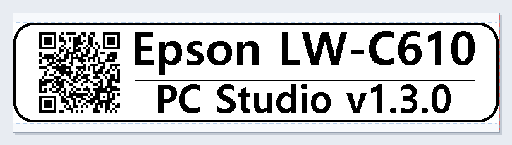
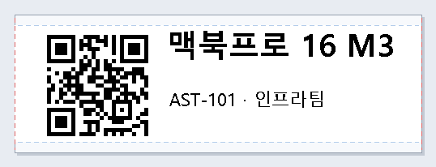
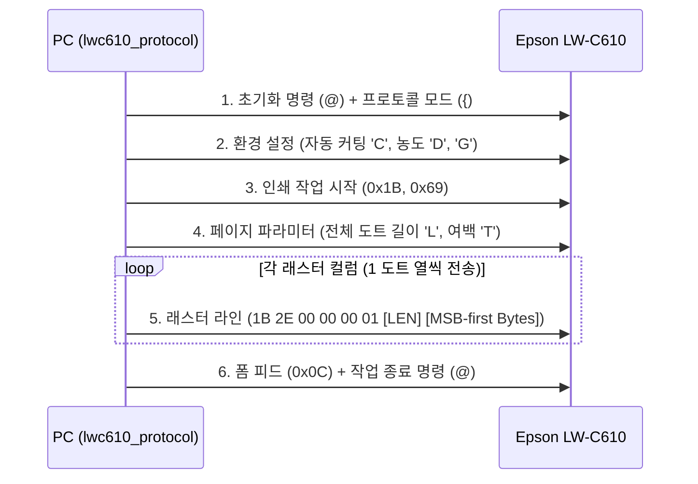

# Epson LW-C610 PC 라벨프린터 스튜디오 (`lw-c610-printer`)

[](https://github.com/mumblemummer/lw-c610-printer/releases)
[](https://www.python.org/)
[](https://opensource.org/licenses/MIT)
[](#2-리버스-엔지니어링-프로토콜-명세-lw-c610)
[](#하드웨어--연결-사양)

스마트폰 전용으로 출시되어 공식 Windows 드라이버가 없는 **Epson LabelWorks LW-C610** 블루투스 라벨프린터를 PC에서 편리하게 사용할 수 있도록 공식 Android SDK(`com.epson.ilabel` v1.8.0 / `classes2.dex` / `libLWPrint.so`)를 리버스 엔지니어링하여 제작한 고해상도 데스크톱(GUI) 및 명령줄(CLI) 프로그램입니다.




---

## 📑 목차
1. [하드웨어 & 연결 사양](#하드웨어--연결-사양)
2. [핵심 기능 하이라이트](#핵심-기능-하이라이트)
3. [설치 및 빠른 시작](#설치-및-빠른-시작)
4. [GUI 데스크톱 모드 상세 가이드](#gui-데스크톱-모드-상세-가이드)
   - [탭 1: 일반 및 2줄 라벨 인쇄](#-탭-1-일반-및-2줄-라벨-인쇄)
   - [탭 2: CSV 다중 출력 및 객체 자유 배치](#-탭-2-csv-다중-출력-및-객체-자유-배치)
   - [72종+ 큐레이션 글꼴 라이브러리](#-72종-큐레이션-글꼴-라이브러리)
5. [CLI (명령줄) 완전 가이드](#cli-명령줄-완전-가이드)
   - [옵션 목록 표](#cli-옵션-목록)
   - [상황별 실행 예제](#상황별-cli-실행-예제)
6. [CSV 템플릿 작성 가이드](#csv-템플릿-작성-가이드)
7. [리버스 엔지니어링 프로토콜 명세 (LW-C610)](#리버스-엔지니어링-프로토콜-명세-lw-c610)
   - [하드웨어 및 통신 모델 사양](#1-모델-프로파일-및-규격)
   - [테이프 규격 및 해상도 매핑](#2-테이프-폭별-인쇄-규격-360-dpi)
   - [프레이밍 및 패킷 체크섬 계산](#3-패킷-프레이밍-및-체크섬)
   - [상태 수신 구조체 (BDC ST2 91바이트)](#4-상태-수신-패킷-구조-bdc-st2-91바이트)
   - [인쇄 시퀀스 및 래스터 비트맵 변환](#5-인쇄-시퀀스-및-래스터-변환-알고리즘)
8. [자주 묻는 질문 (FAQ) & 문제 해결](#자주-묻는-질문-faq--문제-해결)
9. [라이선스](#라이선스)

---

## 하드웨어 & 연결 사양

- **대상 기종**: Epson LabelWorks `LW-C610` (블루투스 장치명: `LW-C610@XXXXXX`)
- **인쇄 방식 & 해상도**: 열전사 인쇄 (Thermal Transfer), **360 DPI** (`14.173 dots/mm`)
- **지원 테이프 규격**: Epson LK 테이프 카트리지 (`4mm`, `6mm`, `9mm`, `12mm`, `18mm`, `24mm`)
- **연결 인터페이스**: Windows Bluetooth 가상 직렬 포트 (SPP, Serial Port Profile, 예: `COM4`)
- **보정 기본값**: 기본 여백 `0.0 mm`, 좌측 시작 보정 `0.0 mm` (첫 글자 잘림 완벽 해결)

---

## 핵심 기능 하이라이트

- **공식 드라이버 없는 Windows 완벽 지원**:
  - Android 네이티브 바이너리(`libLWPrint.so`)의 Level 5 명령어 프로토콜을 순수 Python으로 구현하여 별도의 제조사 소프트웨어 없이 PC에서 다이렉트 무선 인쇄.
- **실시간 테이프 자동 감지 & 상태 조회**:
  - 프린터 연결 즉시 현재 장착된 테이프 폭(mm), 인쇄 가능 높이(dots), 배터리/오류 상태 자동 판독.
- **전용 2줄 라벨 모드**:
  - 1째 줄(상단) / 2째 줄(하단) 분리 입력창 제공.
  - 비율 조절(`1:1`, `6:4 제목 강조`, `4:6 부제 강조`), 줄 간격(dots), 줄 사이 가로 구분선 지원.
- **CSV 데이터 연동 & 자유 객체(X/Y) 배치**:
  - CSV 파일을 로드하여 라벨에 `{열이름}` 템플릿 태그 바인딩.
  - 텍스트, QR 코드, 구분선, 사각형 박스 객체를 원하는 위치(X, Y mm)에 자유롭게 배치.
  - 행별 실시간 360 DPI 렌더링 미리보기 넘겨보기 및 1-클릭 다중 일괄 인쇄.
- **72종+ 큐레이션 글꼴 라이브러리**:
  - 23종 한글 오픈소스 OFL 폰트 번들(고딕, 타이틀, 명조/궁서, 손글씨/감성, 영문 디자인) 내장.
  - 윈도우 시스템 전체 글꼴 자동 탐색, 카테고리 필터링, 1-클릭 이전/다음 폰트 넘기기, 사용자 외부 글꼴(`.ttf`, `.otf`, `.ttc`) 직접 로드 지원.
- **다양한 테두리 및 그래픽 요소**:
  - 직사각형, 둥근 사각형, 굵은 테두리, 캡슐형 프레임.
  - QR 코드 자동 크기 계산 및 위치 지정(좌측, 우측, 단독).
  - 이미지 파일(PNG/JPG/BMP) 삽입 및 Floyd-Steinberg 오차 확산 흑백 디더링.

---

## 설치 및 빠른 시작

### 1. 블루투스 페어링
1. 프린터(LW-C610) 전원을 켭니다.
2. Windows `설정` > `Bluetooth 및 장치` > `장치 추가`에서 `LW-C610@XXXXXX`를 페어링합니다.
3. `장치 관리자` 또는 `추가 Bluetooth 옵션` > `COM 포트` 탭에서 할당된 **송신(Outgoing) COM 포트**(예: `COM4`)를 확인합니다.

### 2. 파이썬 환경 설정 및 의존 패키지 설치
Python 3.9 이상 환경에서 터미널(PowerShell 또는 명령 프롬프트)을 열고 실행합니다:

```powershell
# 저장소 클론
git clone https://github.com/mumblemummer/lw-c610-printer.git
cd lw-c610-printer

# 필수 패키지 설치
pip install -r requirements.txt
```

### 3. 프로그램 실행
- **간편 실행**: `run_lwc610.bat` 파일을 더블클릭합니다.
- **터미널 실행**:
  ```powershell
  python app.py
  ```

---

## GUI 데스크톱 모드 상세 가이드

`app.py`를 실행하면 Tkinter 기반의 360 DPI 실시간 라벨 스튜디오가 열립니다.

### 🏷 탭 1: 일반 및 2줄 라벨 인쇄

| 설정 그룹 | 항목 | 설명 |
| :--- | :--- | :--- |
| **연결 & 테이프** | `포트 (COM)` | 블루투스 가상 시리얼 포트 (기본값: `COM4`, 자동 감지 지원) |
| | `테이프 폭` | 장착된 테이프 규격 선택 (기본: `0: 자동 감지`, 4/6/9/12/18/24mm) |
| **라벨 텍스트** | `1째 줄 (상단)` | 메인 타이틀 또는 1번째 행 텍스트 |
| | `2째 줄 (하단)` | 서브 타이틀 또는 2번째 행 텍스트 (입력 시 자동으로 2줄 모드 활성화) |
| | `2줄 비율` | `1:1 (동일 크기)`, `6:4 (1줄 크게/제목+부제)`, `4:6 (2줄 크게/부제+본문)` |
| | `줄 간격 / 구분선` | 행 사이 간격(dots) 지정 및 줄 사이 가로 구분선 켜기/끄기 |
| **글꼴 & 스타일** | `카테고리` | 전체, 한글 고딕, 한글 굵은/타이틀, 한글 명조/궁서, 손글씨/감성, 영문 디자인 |
| | `글꼴 선택` | 72종 이상의 폰트 중 선택 (◀ 이전 / 다음 ▶ 버튼으로 실시간 변경) |
| | `외부 폰트 파일` | 사용자가 소장한 `.ttf`, `.otf`, `.ttc` 파일을 직접 불러와 적용 |
| | `글꼴 크기` | `0` (테이프 높이에 맞춘 자동 크기 조절) 또는 수동 pt 지정 |
| | `굵게 / 반전` | 볼드(Bold) 효과 및 흑백 반전(Invert) 인쇄 |
| **장식 & 그래픽** | `테두리` | 없음, 직사각형(Simple), 둥근 사각형(Rounded), 굵은 테두리(Bold), 캡슐형(Capsule) |
| | `QR 코드` | 텍스트 또는 URL 입력 (위치: 좌측 / 우측 / 단독) |
| | `이미지 첨부` | 사용자 그래픽 파일 삽입 (자동 흑백 디더링 적용) |
| **정밀 제어** | `기본 여백` | 라벨 시작/끝 여백 (`0.0 mm` ~ `21.0 mm`, 기본값: `0.0 mm`) |
| | `좌측 보정` | 첫 글자 잘림 방지 미세 이동 (`0.0 mm` ~ `10.0 mm`, 기본값: `0.0 mm`) |
| | `인쇄 농도` | `-5` (연하게) ~ `+5` (진하게), 기본값 `0` |
| | `자동 커팅 / 매수`| 인쇄 완료 후 자동 절단 여부 및 인쇄 매수(1~99매) 지정 |

---

### 📊 탭 2: CSV 다중 출력 및 객체 자유 배치

대량의 자산 관리 라벨, 상품 바코드, 주소 라벨, 명찰 등을 일괄 출력할 때 사용합니다.


1. **CSV 파일 불러오기**:
   - `CSV 파일 열기` 버튼을 눌러 `.csv` 파일을 불러옵니다 (UTF-8, CP949 자동 지원).
   - 데이터 열(Column) 목록이 상단에 표시됩니다 (예: `{ID}`, `{품명}`, `{규격}`, `{시리얼}`, `{QR데이터}`).
2. **객체 목록 및 위치(X/Y) 자유 배치**:
   - `+ 텍스트 추가`: 템플릿 텍스트를 입력하고 X, Y 좌표(mm), 폰트 크기, 굵기를 지정합니다.
     - 예: 텍스트에 `{품명}` 입력 시 각 행의 해당 열 데이터로 자동 치환됩니다.
   - `+ QR코드 추가`: QR로 인코딩할 템플릿(예: `{QR데이터}` 또는 `https://example.com/asset?id={ID}`)과 X, Y 위치, 박스 크기를 지정합니다.
   - `+ 구분선 추가`: 가로 또는 세로 구분선의 시작점(X, Y)과 길이(mm), 두께를 설정합니다.
   - `+ 사각형 추가`: 강조하고 싶은 영역의 테두리 박스를 배치합니다.
3. **실시간 행별 미리보기**:
   - `◀ 이전 행`, `다음 행 ▶` 버튼을 클릭하여 실제 각 행 데이터가 치환된 360 DPI 렌더링 결과를 육안으로 확인합니다.
4. **일괄 인쇄**:
   - `전체 N개 일괄 인쇄` 버튼을 누르면 1번 행부터 마지막 행까지 순차적으로 인쇄되며 각 라벨마다 자동 커팅됩니다.

---

### 🎨 72종+ 큐레이션 글꼴 라이브러리

번들 디렉터리(`fonts/`)에 23종의 감각적인 상업적 무료(OFL/Open Source) 폰트를 기본 내장하고 있으며, 윈도우 시스템 폰트와 결합하여 72종 이상의 글꼴을 제공합니다.

- **한글 고딕 / 기본**: Pretendard, 본고딕(Noto Sans KR), 나눔고딕, 맑은 고딕, SUIT 등
- **한글 굵은 / 타이틀**: 배달의민족 도현(DoHyeon), 주아(Jua), 검은고딕(Black Han Sans), 가석체(Gasoek One)
- **한글 명조 / 궁서**: 바탕체, 궁서체, 본명조(Noto Serif KR), 나눔명조
- **손글씨 / 감성**: 배달의민족 연성(YeonSung), 나눔손글씨 펜, 개구쟁이(Gaegu), 동글체(Dongle)
- **영문 / 숫자 디자인**: Montserrat, Oswald, Roboto, Poppins, Arial Black 등
- **사용자 커스텀 폰트**: `외부 폰트 열기`로 다운로드받은 임의의 `.ttf`/`.otf` 폰트 즉시 로드 가능

---

## CLI (명령줄) 완전 가이드

배치 스크립트나 터미널에서 헤드리스(Headless)로 라벨을 출력할 수 있습니다.

### CLI 옵션 목록

```
python app.py [OPTIONS]
```

| 옵션 | 인자 | 설명 | 기본값 |
| :--- | :--- | :--- | :--- |
| `--port` | `PORT` | 블루투스 시리얼 포트 명칭 | `COM4` |
| `--status` | 플래그 | 프린터 실시간 상태 및 테이프 폭 조회 후 종료 | - |
| `--feed` | 플래그 | 테이프 피드 및 커트 실행 후 종료 | - |
| `--text` | `TEXT` | 1째 줄 텍스트 (또는 `\n` 개행을 포함한 텍스트) | `""` |
| `--line2` | `TEXT` | 2째 줄(하단) 전용 텍스트 | 없음 |
| `--line-ratio` | `1:1`, `6:4`, `4:6` | 2줄 텍스트 크기 비율 | `1:1` |
| `--line-gap` | `INT` | 2줄 사이 간격 (도트 단위) | `8` |
| `--line-divider`| 플래그 | 2줄 사이에 가로 구분선 렌더링 | 비활성 |
| `--qr` | `DATA` | 인쇄할 QR 코드 내용/URL | 없음 |
| `--qr-pos` | `left`, `right`, `only` | QR 코드 배치 위치 | `left` |
| `--image` | `PATH` | 삽입할 그래픽 이미지 파일 경로 | 없음 |
| `--font` | `FONT_NAME` | 사용할 글꼴 이름 또는 폰트 파일명 | 기본 고딕 |
| `--font-size` | `FLOAT` | 폰트 크기 (`0` 지정 시 테이프 높이에 자동 맞춤) | `0` |
| `--no-bold` | 플래그 | 글꼴 굵게 효과 끄기 | 보통 굵게 |
| `--invert` | 플래그 | 흑백 반전 인쇄 | 흑백 정상 |
| `--align` | `left`, `center`, `right` | 텍스트 정렬 방식 | `center` |
| `--frame` | `FRAME_NAME` | 테두리 (직사각형, 둥근 사각형, 굵은 테두리, 캡슐형) | 없음 |
| `--tape-code` | `0~6` | 테이프 코드 강제 지정 (`0`: 프린터 자동 감지) | `0` |
| `--margin` | `FLOAT` | 기본 좌우 여백 (mm) | `0.0` |
| `--lead-offset`| `FLOAT` | 좌측 시작 잘림 방지 보정 여백 (mm) | `0.0` |
| `--density` | `-5 ~ +5` | 인쇄 농도 조절 | `0` |
| `--copies` | `1 ~ 99` | 인쇄 매수 | `1` |
| `--no-cut` | 플래그 | 인쇄 후 자동 커팅 끄기 | 자동 커팅 |
| `--save-preview`| `PATH` | 360 DPI 렌더링 비트맵을 PNG 파일로 저장 | 없음 |
| `--offline` | 플래그 | 프린터 하드웨어 연결 없이 미리보기 렌더링만 수행 | 비활성 |
| `--csv-batch` | `PATH` | CSV 파일을 읽어 다중 라벨 일괄 연속 인쇄 | 없음 |

---

### 상황별 CLI 실행 예제

#### 1. 프린터 연결 및 테이프 상태 확인
```powershell
python app.py --port COM4 --status
```
> 출력 결과:
> ```
> [연결] COM4 포트 연결 성공
> [상태] 프린터 준비 완료 (Idle)
> [테이프] 12mm LK 테이프 장착됨 (인쇄 가능 높이: 144 dots)
> ```

#### 2. 둥근 테두리를 적용한 기본 텍스트 라벨
```powershell
python app.py --text "보관용 파일철 No.1" --frame "둥근 사각형 (Rounded)"
```

#### 3. 2줄 라벨 인쇄 (제목 크게 + 가로 구분선)
```powershell
python app.py --text "자산 관리 번호" --line2 "ASSET-2026-0042" --line-ratio "6:4" --line-divider --frame "직사각형 (Simple)"
```

#### 4. QR 코드 + 2줄 설명 라벨
```powershell
python app.py --qr "https://github.com/mumblemummer/lw-c610-printer" --qr-pos left --text "LW-C610 스튜디오" --line2 "오픈소스 프로젝트" --line-ratio "6:4"
```

#### 5. 개성 있는 폰트 및 굵은 테두리 적용
```powershell
python app.py --text "특급 취급주의" --font "BlackHanSans-Regular" --frame "굵은 테두리 (Bold)"
```

#### 6. CSV 파일 기반 대량 일괄 인쇄
```powershell
python app.py --csv-batch sample_data.csv
```

#### 7. 오프라인 미리보기 PNG 생성 (프린터 없이 테스트)
```powershell
python app.py --text "테스트 라벨" --save-preview preview.png --offline
```

---

## CSV 템플릿 작성 가이드

프로젝트 루트의 `sample_data.csv`는 다음과 같이 구성되어 있습니다:

```csv
ID,품명,규격,시리얼,QR데이터
A-01,멀티탭 6구 3M,250V 16A,SN-2026-001,https://label.internal/item/A-01
A-02,USB-C 고속충전기,65W GaN,SN-2026-002,https://label.internal/item/A-02
A-03,무선 버티컬 마우스,블루투스 5.0,SN-2026-003,https://label.internal/item/A-03
A-04,HDMI 2.1 케이블,4K 120Hz 2M,SN-2026-004,https://label.internal/item/A-04
A-05,모니터 받침대,원목 50cm,SN-2026-005,https://label.internal/item/A-05
```

- CSV 첫 번째 줄의 헤더명이 템플릿 태그가 됩니다.
- 텍스트 입력창이나 QR 입력창에 `{품명}`, `{ID}`, `{시리얼}`과 같이 중괄호로 묶어 입력하면 각 행의 데이터로 자동 치환됩니다.
- 한 줄에 여러 태그를 조합할 수도 있습니다: `[{ID}] {품명} ({규격})`

---

## 리버스 엔지니어링 프로토콜 명세 (LW-C610)

본 드라이버는 공식 앱 `epson_ilabel.apk`(`com.epson.ilabel` v1.8.0) 및 포함된 네이티브 라이브러리 `libLWPrint.so`의 바이너리 분석을 통해 구현되었습니다.

### 1. 모델 프로파일 및 규격

- **Model Name**: `"LW-C610"`
- **Model Number**: `1301` (`PrintCoreModelNumberLWC610`)
- **DPI**: `360 DPI` (`14.173 dots/mm`)
- **Command Level**: `ProductCommandLevel5`
- **Protocol Driver**: `AccessManagerBluetooth2`
- **Auto-Cut**: 지원 (`CutModeAuto`) / **Half-Cut**: 미지원

### 2. 테이프 폭별 인쇄 규격 (360 DPI)

공식 네이티브 라이브러리의 `getPrintableSize` 함수 테이블 매핑:

| 테이프 코드 | 상태 패킷 `TW` 바이트 | 테이프 폭 (mm) | 인쇄 가능 높이 (dots) | 라인당 래스터 바이트 |
| :---: | :---: | :---: | :---: | :---: |
| `1` | `0x0B` / `0x5B` | **4 mm** | **44 dots** | 6 bytes |
| `2` | `0x01` / `0x51` | **6 mm** | **72 dots** | 9 bytes |
| `3` | `0x02` / `0x52` | **9 mm** | **108 dots** | 14 bytes |
| `4` | `0x03` / `0x53` | **12 mm** | **144 dots** | 18 bytes |
| `5` | `0x04` / `0x54` | **18 mm** | **216 dots** | 27 bytes |
| `6` | `0x05` / `0x55` | **24 mm** | **256 dots** *(1301 전용 예외값)* | 32 bytes |

> **24mm 주의사항**: 표준 360 DPI 24mm 공식 크기는 288도트이나, LW-C610 하드웨어 헤드 제한으로 `256 dots` (32바이트)로 클램핑됩니다.

---

### 3. 패킷 프레이밍 및 체크섬

모든 제어 명령은 `CommandFilter::makeCommand` 구조를 준수합니다:

```
[0x1B] [0x7B] [LEN] [CMD] [PAYLOAD...] [CHECKSUM] [0x7D]
```

- **LEN**: `len(PAYLOAD) + 3`
- **CHECKSUM**: `(CMD + sum(PAYLOAD)) & 0xFF`
- 예: 상태 요청 명령 (`CMD=0x49`, `PAYLOAD=[0x00, 0x00]`):
  - `LEN = 2 + 3 = 0x05`
  - `CHECKSUM = (0x49 + 0x00 + 0x00) & 0xFF = 0x49`
  - 최종 패킷: `1B 7B 05 49 00 00 49 7D`

---

### 4. 상태 수신 패킷 구조 (BDC ST2 91바이트)

프린터는 상태 요청에 대해 다음 91바이트 바이너리 프레임을 응답합니다:

```
00..12 (13B): "@BDC ST2\r\nP\x00;" (헤더)
13..90 (78B): 상태 페이로드 (Status Payload)
```

- **오프셋 23 (`TW` - Tape Width)**: 현재 장착된 테이프 카트리지 폭 코드
- **오프셋 15 (`ST` - Device Status)**: 프린터 상태 플래그
  - `0x00`: 정상 대기 (Ready / Idle)
  - `0x01`: 인쇄 중 (Printing)
  - `0x02`: 일시 정지 (Paused)
  - `0x04`: 오류 발생 (커버 열림, 테이프 없음 등)
- **오프셋 17 (`BT` - Battery Level)**: 배터리 잔량 레벨

---

### 5. 인쇄 시퀀스 및 래스터 변환 알고리즘

인쇄 작업은 다음의 엄격한 6단계 시퀀스로 진행됩니다:



- **비트맵 변환 (`bitmapToRaster`)**:
  - 인쇄 이미지는 1비트 흑백 비트맵(1: 인쇄 도트, 0: 백색)으로 렌더링됩니다.
  - 라벨의 가로 방향 진행에 따라 각 수직 열(Column, $H$ 도트)을 8도트씩 묶어 MSB-first 바이트로 직렬화하여 전송합니다.

---

## 자주 묻는 질문 (FAQ) & 문제 해결

### Q1. "포트를 열 수 없습니다 (PermissionError / FileNotFoundError)"
- Windows 블루투스 설정에서 프린터가 켜져 있고 연결 상태인지 확인하세요.
- 다른 프로그램(또는 이전 실행 인스턴스)이 해당 COM 포트를 점유하고 있으면 열리지 않습니다. 작업 관리자에서 파이썬 프로세스를 확인하세요.

### Q2. 첫 글자의 왼쪽이 살짝 잘려서 나옵니다.
- 본 프로그램은 기본 여백 `0.0 mm`에서도 첫 글자 잘림을 방지하도록 폰트 바운딩 박스를 정밀 보정(`_render_text_tight`)하고 있습니다.
- 카트리지 유격 등으로 인한 물리적 오차가 발생할 경우 GUI의 `좌측 보정` 값을 `0.5 ~ 1.0 mm`로 약간 주시면 완벽하게 출력됩니다.

### Q3. 테이프를 교체했는데 프로그램에서 크기가 안 바뀝니다.
- 새 카트리지를 장착한 후 GUI 상단의 `상태 확인` 버튼을 누르면 즉시 새로운 테이프 폭을 재인식합니다.

---

## 라이선스

본 프로젝트는 [MIT License](LICENSE)에 따라 자유롭게 사용, 수정, 배포할 수 있습니다.
Epson, LabelWorks 및 관련 상표는 Seiko Epson Corporation의 등록 상표입니다. 본 프로젝트는 공식 제품이 아니며 독립적인 리버스 엔지니어링 연구를 바탕으로 개발되었습니다.
